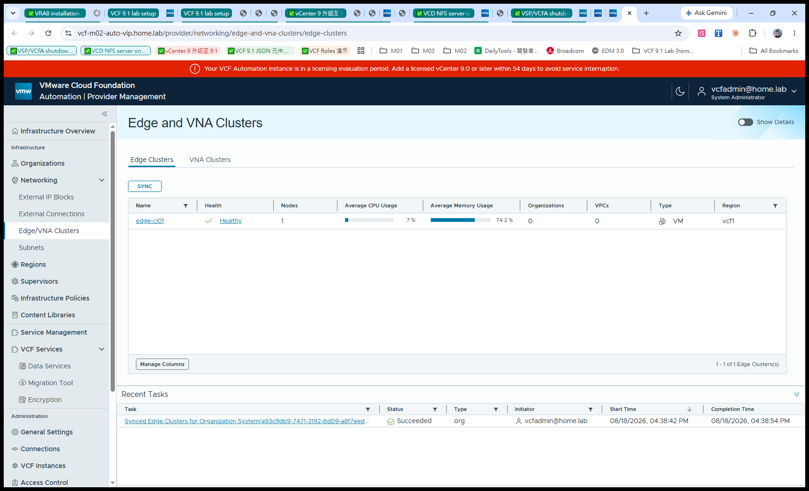
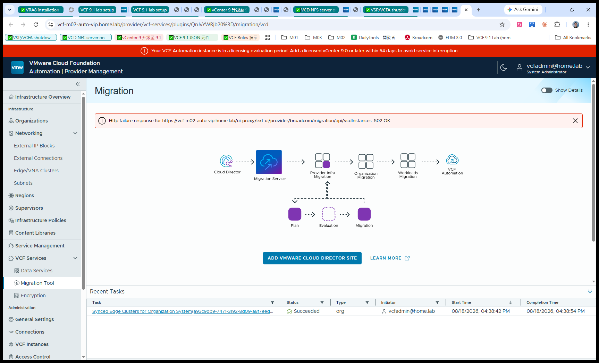

# VCFA 側：Edge 對應與 Migration Tool 現況

承接 [`README.md`](README.md)（VCD 側）與 [`bridge-state.md`](bridge-state.md)（架構概念）。
這篇記錄 **bridge 的另一半**：在 VCF Automation 這邊看到什麼、Edge 怎麼對應、
以及 VCD→VCFA Migration Tool 的實際狀態。

## 重點結論：VCFA 的 Edge Cluster 不是「建」的，是「同步」的

在 VCFA Provider Management → **Networking → Edge/VNA Clusters**，
畫面上**只有一個 `SYNC` 按鈕，沒有 New/Create**。

因為 Edge Cluster 的真實來源是 **NSX**。VCFA 只是把 NSX 既有的 edge cluster 同步進來納管。

所以當我們為了 VCD 的 Edge Gateway 在 NSX 建好 `edge-cl01` 之後，
VCFA 這邊按一次 SYNC 就直接對應上了：



| 欄位 | 值 |
|---|---|
| Name | `edge-cl01` |
| Health | **Healthy** |
| Nodes | 1 |
| Type | VM |
| Region | `vcf1` |
| Organizations / VPCs | 0 / 0（尚未被 VCFA 租戶使用）|

Recent Tasks 顯示 `Synced Edge Clusters for Organization System … Succeeded`。

### 這正是 bridge 的具體證據

**同一個 NSX edge cluster，同時服務兩邊**：

```
                    NSX 9.1
                  edge-cl01  (1 node, Healthy)
                       │
        ┌──────────────┴──────────────┐
        │                             │
   VCD 10.6.2                     VCF Automation
   Tier-0 t0-gw01                 Edge/VNA Clusters
   └ Edge Gateway (T1)            └ 已同步納管
      tenant01-edge                  (可供 VPC 使用)
```

不需要為了 VCFA 另外部署一組 edge — 這就是「同一批硬體、兩套消費層並存」。

> 對照：VCD 側的 Edge Gateway 建立方式與踩到的坑見 [`README.md`](README.md)。

## Migration Tool（VCD → VCFA）

位置：**VCF Services → Migration Tool**。



UI 直接畫出了整條遷移鏈：

```
Cloud Director → Migration Service → Provider Infra Migration
   → Organization Migration → Workloads Migration → VCF Automation

                    Plan → Evaluation → Migration
```

入口是 **ADD VMWARE CLOUD DIRECTOR SITE**：加入並註冊一個 VCD site 之後，
VCFA 會跑一次 evaluation、提出建議的 migration plan，
可以直接遷移、也可以先編輯 plan 再執行。

### ⚠️ 目前狀態：後端 502，流程走不下去

畫面上持續出現：

```
Http failure response for
https://<vcfa>/ui-proxy/ext-ui/provider/broadcom/migration/api/vcdInstances: 502
```

點 `ADD VMWARE CLOUD DIRECTOR SITE` 沒有反應（對話框不會開），
因為 `vcdInstances` 取不到。

診斷佐證：

| 測試 | 結果 | 意義 |
|---|---|---|
| `curl` 直打該 API（未帶 token） | `401` | ui-proxy 與路由正常，端點存在 |
| 瀏覽器（帶 token）打同一 API | `502` | 打到後端了，但 **migration service 本身不可用** |
| VCFA 其他端點 `/automation/`、`/tm/login/` | `200` | VCFA 主體正常 |

→ 結論：**不是 VCFA 整體壞掉，是 migration 這個 service/plugin 的後端沒起來**。
要跑 migration 得先讓該服務恢復。

## 附帶觀察

- VCFA 執行個體處於 **licensing evaluation**（提示需在期限內加入已授權的 vCenter 9.0+）。
- Infrastructure Overview：Organizations 1 / Regions 1 / Supervisors 1 / Content Libraries 0。

---

*實機驗證於 2026-08，VCF 9.1 nested lab。截圖為 VCFA Provider Management console。*

---

# 追查：Migration Tool 502 的根因

`/ui-proxy/ext-ui/provider/broadcom/migration/api/vcdInstances` 持續回 **502**，
`ADD VMWARE CLOUD DIRECTOR SITE` 因此無法開啟。以下是完整的排除過程與結論。

## 結論（先講）

**後端元件 `VCF_SERVICE_VCD_MIGRATION_BACKEND`（約 521 MB）從未被部署到環境。**

環境裡只有 UI 層：

| 元件 | 角色 | 大小 |
|---|---|---|
| `vcd-migrator-plugin-*.tgz` | UI plugin | **824 bytes** |
| `vcd-migrator-*.tgz` | **後端 PACKAGE** | **547 MB** ← 缺這個 |

depot manifest 指明後端的 `rootNamespace: vcd-migrator`，而 Supervisor 上**不存在該 namespace**
（`kubectl get ns | grep -i migrat` 無結果，也沒有任何 migrator workload）。

所以 `ApiExtensionProxy` 註冊成功、狀態 Healthy，但它要轉發的目標根本不存在 → **502**。

## 決定性證據

```bash
# 不只某個 API 壞掉，是整個後端不存在
GET  /migration/api/vcdInstances -> 502
POST /migration/api/vcdInstances -> 502
GET  /migration/api/health       -> 502
GET  /migration/api/version      -> 502
```

`/health` 都 502 → 後端沒有在監聽，而非某支 API 有 bug。

## 排除過的假設（全部推翻）

| 假設 | 做法 | 結果 |
|---|---|---|
| add-on 註冊層壞了 | Service Management **Uninstall → Install** | 三元件重建 Healthy，**502 不變** |
| 後端 process 卡死 | **整台 VCFA 優雅重啟**（照 runbook 順序） | 服務乾淨重啟，**502 不變** |
| 資源不足 | 檢查 VM / 叢集 | CPU 43% / MEM 22%，容量充足 |
| 已知 bug | Migration Guide Appendix C | 沒有這條 |
| 缺 Workload Domain 前置 | 對照官方 Scenario 1 | **不成立**：consolidated 模式官方支援，且 Supervisor 已正確掛在管理域 vCenter |
| VCF Operations 未註冊導致 LCM 失效 | 檢查 Lifecycle | **不成立**：Lifecycle 正常，domain 元件都 On Target |

> ⚠️ 中間兩次歸因錯誤（缺 Workload Domain、授權未註冊）都已驗證推翻，
> 留在這裡是為了讓後人不必重走這兩條死路。

## depot 側的事實

用戶自建的 offline depot **有完整的後端包**：

```
/depot/PROD/COMP/VCF_SERVICE_VCD_MIGRATION_BACKEND/
├── vcd-migrator-9.1.0.0200.25556825.tgz         (547 MB, PACKAGE)
├── vcd-migrator-plugin-9.1.0.0200.25556825.tgz  (824 B,  PLUGIN_PACKAGE)
├── configuration-schema-vcd-migrator-*.yaml
└── depot-manifest-vcd-migrator-*.yaml
```

而且 **Fleet Manager 已正確連上 offline depot**：

```
VCF Operations → Build → Software Depot → <fleet01>
  Offline Depot: ✓ Connected to offline depot
  URL: https://<depot-server>:443
  Storage: 7.51 GB used / 999.51 GB
```

SDDC Manager 也**看得到**這些 bundle：

```
VCF_SERVICE_VCD_MIGRATION_BACKEND
  9.1.0.0200.25556825  INSTALL / PATCH
  9.1.0.0.25370929     INSTALL / PATCH
  downloadStatus: PENDING     ← 從未下載
```

## VCD 側早已就緒（不是 VCD 的問題）

VCD 10.6.2 的 cell 已具備 migration 所需的機制：

```
cell-management-tool manage-secret-migration-keys
  - Add or remove the public keys that are used encrypt secrets
    during VCD to VCFA migration
```

（`/data/migrator-keys.json` 尚未建立是正常的 —— 那是 Add Site 之後的步驟，見 Migration Guide p.15。）

## 卡住的地方：如何讓 Fleet Manager 把 image 拉進來

正確的架構是：

```
offline depot ──► Fleet Manager (content-gateway) ──► VCFA service catalog ──► 安裝後端
                        ▲ 已連線                          ▲ 只認得 9.1.0.0100
                        │                                   (depot 裡是 9.1.0.0200)
             image 尚未拉進來（storage 未增加）
```

嘗試過但**不是**正確入口：

- 用 SDDC Manager API `PATCH /v1/bundles/{id}` 觸發下載 → 任務 **SUCCESSFUL**，
  但 Fleet Manager 的 depot storage **沒有增加**（仍 7.51 GB）→ 進的是 SDDC Manager 自己的儲存
- VCF Operations → Lifecycle → **Manage Components** → 只有 *VCF Operations HCX* 與 *Avi Load Balancer*，
  VCF services 不從這裡安裝
- VCF Operations → Lifecycle → VCF Instances → domain → **Component Versions** → 只管
  SDDC Manager / NSX / vCenter / ESX，不含 VCF services

### 下一步建議

需要找到「讓 Fleet Manager 從 depot 拉取 VCF service image」的正確入口，可能是：

1. Fleet Manager 端的 depot 同步 / image 拉取動作（UI 或 API）
2. VCFA service-manager 從 depot 取 PACKAGE 的機制（可能需要 appliance 層存取）
3. 向 Broadcom 確認 gated 版 migration service 的後端佈署程序

> 註：VCFA appliance 的 root 密碼不在 SDDC Manager credential store、
> 不在 Supervisor secret、也不是 bring-up spec 的密碼，因此無法從 appliance 內部檢視或部署。

